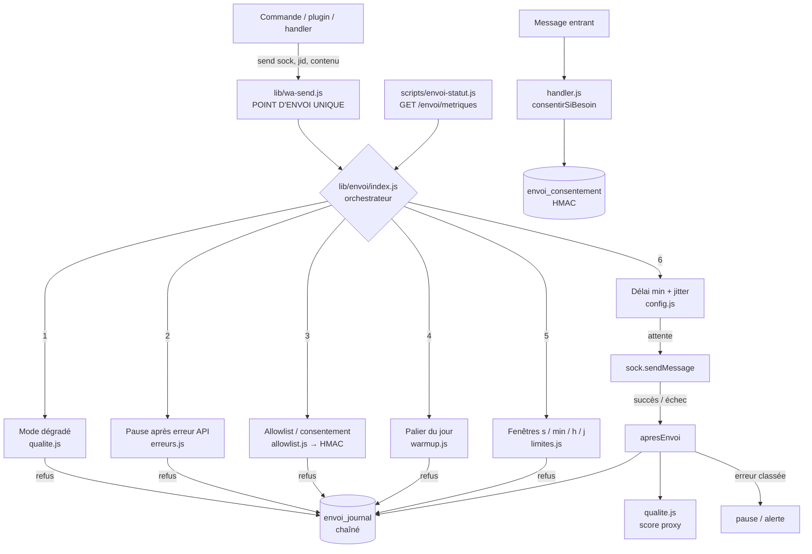

# Contrôle d'envoi WhatsApp — DJOUSSE TECH MD

Système de limitation, de consentement et d'audit pour **tous** les messages
sortants du bot. Objectif : rendre un envoi hors budget ou hors allowlist
**structurellement impossible**, pas seulement déconseillé.

---

## 1. Décisions structurantes (à lire avant le reste)

| Sujet | Décision | Conséquence |
|---|---|---|
| Transport | **Baileys uniquement** | Aucun accès au WABA → le *Quality Rating* officiel et les *Messaging Limits* de Meta sont **inaccessibles**. |
| Qualité | **Proxy local** (`lib/envoi/qualite.js`) | Score calculé sur les succès/échecs réels sur 7 jours. Ce n'est **pas** la note officielle, et le code le dit partout. |
| Base | **SQLite `data/bot.db`** (`node:sqlite`) | Le dépôt n'utilise MongoDB que pour les sessions de jumelage (`index.js`). L'audit doit rester inscriptible même si le réseau tombe : il vit donc dans le fichier local. |
| Allowlist | Mode `reponse` par défaut | Un correspondant qui écrit au bot est consenti (horodaté). Les envois **proactifs** vers un inconnu sont refusés. `strict` = opt-in explicite seulement. |
| Numéros | **HMAC-SHA256 uniquement** | Aucun numéro en clair dans les tables d'envoi. Le sel vient de `ENVOI_SEL` (recommandé) ou est généré et persisté. |
| Anti-détection | **Refusé** | Pas de fautes de frappe simulées. On garde le *pacing* (jitter, délais, fenêtres) et les variantes de contenu : protéger la réputation, pas tromper la détection. |
| Hors périmètre | `lib/wa-agent-bridge.js` | Canal officiel « Agent Platform », avec ses propres quotas WhatsApp. Il ne passe pas par `wa-send` et n'est pas concerné. |

> **Pourquoi Baileys est structurant pour la sécurité** : il n'existe qu'un seul
> point d'envoi (`lib/wa-send.js`), et `scripts/audit.js` fait **échouer l'audit**
> si un autre fichier appelle `.sendMessage(`. Brancher le contrôle dans ce
> chokepoint rend la règle « aucun envoi ne peut contourner le limiteur »
> vraie par construction (garantie G2), pas par discipline.

---

## 2. Architecture — 5 couches



### Ordre des contrôles (aucun n'est facultatif)

1. **Type de contenu** : réactions / suppressions / protocole → hors budget et sans délai.
2. **Mode dégradé** : qualité basse, échecs consécutifs, `ENVOI_DEGRADE=1` → refus.
3. **Pause globale** : conséquence d'une erreur API (`429`, `463`…) → refus.
4. **Allowlist** : refus **avant toute construction de message et tout appel réseau**.
5. **Warm-up** : palier du jour dépassé → refus explicite.
6. **Fenêtres glissantes** : minute/heure/jour → refus (budget). Seconde → **attente**.
7. **Rythme** : délai minimum + jitter aléatoire.

> La fenêtre « seconde » fait **attendre** au lieu de refuser : sans cela un menu
> envoyé 300 ms plus tôt ferait jeter la réponse au chiffre suivant. L'attente
> revérifie quand même les budgets minute/heure/jour, qui ne peuvent donc pas
> être contournés.

---

## 3. Arborescence

```
src/config/
└── envoi.json                 Tous les réglages (relu à chaud, sans redéploiement)

src/lib/envoi/
├── index.js                   Orchestrateur : avantEnvoi / apresEnvoi / consentement
├── config.js                  Chargement, validation, surcharges .env d'urgence
├── store.js                   SQLite : consentement HMAC, journal chaîné, état
├── limites.js                 Fenêtres glissantes pures + mesure réelle
├── warmup.js                  Paliers quotidiens (J1 → J14), refus explicite
├── allowlist.js               Consentement vérifié avant tout appel réseau
├── erreurs.js                 Classification des erreurs + action corrective
├── qualite.js                 Score proxy 7 jours + mode dégradé
└── tableau-bord.js            Handler HTTP /envoi/* (monté par pairing-api.js)

scripts/
├── migrate-envoi.js           Création idempotente des tables + vérification
└── envoi-statut.js            État, historique d'un numéro, opt-in, rétablissement

test/
├── envoi.test.js              26 tests (fenêtres, warm-up, HMAC, erreurs, chaîne)
└── menu-numerique.test.js     Régression : `.menu` + chiffre répond

docs/envoi/README.md           Ce document
```

---

## 4. Configuration

Source de vérité : **`src/config/envoi.json`**. Le fichier est relu
automatiquement quand sa date de modification change : pas besoin de redéployer.

```json
{
  "actif": true,
  "rythme": { "delaiMinMs": 250, "jitterMinMs": 0, "jitterMaxMs": 1500, "pauseApresPanneMs": 30000 },
  "limites": { "parSeconde": 1, "parMinute": 20, "parHeure": 200, "parJour": 500 },
  "warmup": { "actif": true, "dateDebut": null,
    "paliers": [50, 80, 120, 160, 200, 250, 300, 350, 400, 450, 500, 500, 500, 500] },
  "qualite": { "fenetreJours": 7, "seuilAlerte": 60, "seuilDegrade": 40, "echecsConsecutifsMax": 5 },
  "allowlist": { "mode": "reponse", "consentementAutomatique": true },
  "approbation": { "seuilCampagne": 50 },
  "alertes": { "refusParMinute": 5, "fichier": "logs/envoi-alertes.log" },
  "audit": { "retentionJours": 180 }
}
```

| Clé | Effet |
|---|---|
| `rythme.delaiMinMs` | Délai incompressible entre deux envois |
| `rythme.jitterMaxMs` | Jitter aléatoire ajouté (0 = aucun) |
| `limites.parSeconde` | Plafond par seconde (minimum 1). Au-delà → attente |
| `limites.parMinute/heure/jour` | Budgets. Au-delà → refus journalisé |
| `warmup.paliers` | Nombre de messages autorisés chaque jour, dans l'ordre |
| `warmup.dateDebut` | `null` = le premier envoi réel démarre le plan |
| `qualite.seuilDegrade` | Score sous lequel les envois sont suspendus |
| `qualite.echecsConsecutifsMax` | Nombre d'échecs d'affilée avant suspension |
| `allowlist.mode` | `reponse` (implicite) ou `strict` (opt-in explicite) |
| `allowlist.consentementAutomatique` | `false` = même le mode `reponse` exige un opt-in |
| `audit.retentionJours` | Purge automatique du journal (1×/jour max) |

### Surcharges d'urgence (`.env`, prioritaires)

```bash
ENVOI_ACTIF=0          # coupe le contrôle (plus aucun plafond : à éviter)
ENVOI_MODE=strict      # opt-in explicite uniquement
ENVOI_WARMUP=0         # désactive les paliers
ENVOI_DEGRADE=1        # arrêt immédiat des envois
ENVOI_MAX_MINUTE=10
ENVOI_MAX_HEURE=100
ENVOI_MAX_JOUR=250
ENVOI_DELAI_MIN=500
ENVOI_JITTER_MAX=3000
ENVOI_SEL=...          # sel HMAC (32+ caractères)
ENVOI_DASH_TOKEN=...   # jeton du dashboard
```

> `ENVOI_ACTIF=0` est un commutateur de **dépannage**, pas un mode de
> fonctionnement : il rétablit les rafales sans limite. À réserver à un
> diagnostic, et à remettre à `1` immédiatement après.

---

## 5. Installation et migration

```bash
# 1. Créer les tables (idempotent)
node scripts/migrate-envoi.js

# 2. Consentir explicitement le propriétaire (opt-in horodaté)
node scripts/migrate-envoi.js --proprietaire +2376XXXXXXXX

# 3. Vérifier
node scripts/envoi-statut.js
```

Au démarrage, `index.js` consent automatiquement le numéro de session
(`amorcerProprietaires`) : le propriétaire a installé et appairé le bot, son
consentement est explicite par construction. En mode `strict`, cette amorce
est volontairement ignorée.

### Déploiement Fly.io / Render

Les fichiers `deployment/fly.toml` et `deployment/render.yaml` existent déjà.
Ajoutez les variables `ENVOI_*` dans les *secrets* de la plateforme, puis :

```bash
fly secrets set ENVOI_SEL="$(openssl rand -hex 32)" ENVOI_DASH_TOKEN="$(openssl rand -hex 24)"
fly deploy
```

**Un seul processus** : les compteurs vivent dans SQLite. Ne lancez pas deux
instances Baileys sur la même session.

---

## 6. Dashboard et CLI

Le handler HTTP est monté par `src/lib/pairing-api.js` (actif si `PAIRING_API=on`).

| Route | Rôle |
|---|---|
| `GET /envoi/metriques` | Quotas, qualité, warm-up, audit, allowlist |
| `GET /envoi/sante` | `200` si sain, `503` si dégradé / pause / inactif |
| `GET /envoi/audit?limite=50` | Derniers événements (numéros hachés) |
| `GET /envoi/audit/:empreinte` | Historique complet d'un numéro |
| `POST /envoi/retablir` | Sortie manuelle du mode dégradé |

Authentification : `x-api-token` ou `?token=`, valeur de `ENVOI_DASH_TOKEN`
(à défaut `PAIRING_API_TOKEN`). **Sans jeton configuré, tout répond 403** : un
dashboard public est une fuite d'information.

```bash
curl -H "x-api-token: $ENVOI_DASH_TOKEN" http://localhost:8089/envoi/metriques
node scripts/envoi-statut.js --json
```

---

## 7. Tests

```bash
node --test test/envoi.test.js
node --test test/menu-numerique.test.js
npm test          # suite complète
```

`test/envoi.test.js` couvre : les 4 fenêtres, le warm-up (paliers, jour futur,
plan inactif), l'allowlist (inconnu, strict, jid à appareil, statut), le refus
**avant** `sock.sendMessage`, l'attente « seconde », le refus « minute », les
6 classes d'erreurs, la pause globale, le mode dégradé, l'intégrité de la
chaîne d'audit et la non-présence de numéros en clair.

`test/menu-numerique.test.js` est la **régression** du bug « le bot ne répond
pas quand je tape un chiffre » : elle lance le vrai handler, envoie `.menu`
puis `1`, et exige deux messages.

---

## 8. Procédures d'urgence

### Qualité proxy sous le seuil (mode dégradé automatique)

Symptôme : `GET /envoi/sante` → `503`, logs `[ENVOI][ALERTE] envois suspendus`.

1. `node scripts/envoi-statut.js` → lire `degradeRaison` et le score.
2. Chercher la cause : `--historique` sur le destinataire concerné, `--alertes`.
3. Corriger (numéro invalide, contenu refusé, service instable), puis :
   `node scripts/envoi-statut.js --retablir`.
4. Reprendre à rythme réduit : `ENVOI_MAX_MINUTE=5` pendant 24 h.

### `REACHOUT_RESTRICTED` (403 / 463)

Le numéro est restreint pour les messages proactifs. Le système pose une pause
globale de **24 h** et refuse tout envoi.

1. **Ne pas** réessayer en boucle (anti-pattern explicite).
2. Vérifier que les destinataires ont bien consenti (`--historique`).
3. Attendre la fin de la pause ; reprendre uniquement sur réponses entrantes.
4. Si la restriction persiste > 48 h : suspendre les envois (`ENVOI_DEGRADE=1`).

### `RATE_OVERLIMIT` (429 / 131056)

Pause automatique de **15 min**, sans retry. Réduire `limites.parMinute` et
`parHeure` dans `envoi.json` (relu à chaud), puis vérifier `fenetres` dans le
dashboard avant de reprendre.

### `SESSION_INVALID` (401)

Le bot est déconnecté : réappairer la session. Aucune action sur le limiteur ;
les envois échouent de toute façon.

### Palier de warm-up dépassé

Refus `WARMUP_PALIER_DEPASSE`, journalisé. C'est **le comportement attendu**.
Ne pas augmenter le palier du jour pour « faire passer » un lot : décaler le
lot au lendemain ou augmenter le plan **avant** le début du cycle.

### Chaîne d'audit rompue

`verifierChaine()` renvoie `ok: false` → une ligne a été modifiée ou supprimée.

1. Sauvegarder `data/bot.db` (preuve).
2. Identifier la première ligne incohérente (`ts` retourné dans `rupture`).
3. Ne pas « réparer » la chaîne : elle est la preuve. Archiver la base et
   repartir sur un journal neuf si nécessaire.

### Base indisponible / `node:sqlite` absent

Le module bascule en **mémoire** et le signale au démarrage :
`[ENVOI] node:sqlite indisponible — journal d'audit EN MÉMOIRE (non durable)`.
Les envois restent limités, mais l'audit n'est plus durable. Corriger la
version de Node (≥ 22.5) avant de considérer la conformité comme acquise.

---

## 9. Plan de monitoring

| Métrique | Source | Seuil d'alerte | Action |
|---|---|---|---|
| Score qualité proxy | `/envoi/metriques` → `qualite.score` | < 60 | Surveiller ; réduire le rythme |
| Score qualité proxy | idem | < 40 | **Automatique** : mode dégradé, envois suspendus |
| Échecs consécutifs | `qualite.echecsConsecutifs` | ≥ 3 | Inspecter la cause |
| Échecs consécutifs | idem | ≥ 5 | **Automatique** : mode dégradé |
| Refus / minute | `envoi_journal` (`resultat = 'refus'`) | > 5 | Vérifier allowlist et budgets |
| Fenêtre minute | `/envoi/metriques` → `fenetres.parMinute` | ≥ 90 % du plafond | Réduire le débit ou le lot |
| Fenêtre jour | idem | ≥ 90 % du plafond | Décaler au lendemain |
| Palier warm-up | `warmup.envoyesJour / palier` | ≥ 100 % | Normal : le jour est clos |
| Pause globale | `pauseJusqua` | non nul | Lire `--alertes`, ne pas retenter |
| Chaîne d'audit | `audit.chaine.ok` | `false` | Incident de sécurité : archiver la base |
| Santé HTTP | `/envoi/sante` | `503` | Dashboard/alerte : bot suspendu |
| Taille du journal | `COUNT(*)` | > 5 M lignes | Vérifier la purge (`audit.retentionJours`) |

Alertes fichier : `data/logs/envoi-alertes.log`, débit limité à **1 par minute**
pour ne pas noyer les logs. Chaque alerte contient l'horodatage ISO, le code et
la raison ; le numéro n'y figure jamais en clair.

---

## 10. Modèle de sécurité

- **Aucun numéro en clair** dans `envoi_consentement` ni `envoi_journal` :
  HMAC-SHA256 avec sel. `ENVOI_SEL` est recommandé ; sans lui, le sel est
  généré et persisté, donc un vol de `bot.db` permettrait une attaque par
  force brute sur l'espace des numéros.
- **Journal chaîné** : chaque ligne contient `empreinte_prec` ; toute
  modification ou suppression rompt la vérification (`verifierChaine`).
- **Rétention** : purge quotidienne au-delà de `audit.retentionJours`.
- **Dashboard fermé par défaut** : 403 sans jeton.
- **Refus avant réseau** : l'allowlist est évaluée avant toute construction de
  message ; un numéro inconnu ne produit aucun appel `sock.sendMessage`.
- **Pas de retry agressif** : `erreurs.js` décide `retenter: false` pour
  `RATE_OVERLIMIT`, `REACHOUT_RESTRICTED`, `INVALID_RECIPIENT` et `UNKNOWN`.

### Limites assumées

- Le *Quality Rating* n'est pas la métrique officielle de Meta : c'est un
  indicateur local, honnêtement nommé `proxy-local`.
- Les *Messaging Limits* du WABA ne sont pas interrogeables sans compte Meta.
- `wa-agent-bridge.js` (canal officiel) applique ses propres quotas et ne
  passe pas par ce contrôle.
- SQLite suppose **un seul processus** ; plusieurs instances exigeraient un
  état partagé (Redis/PostgreSQL) pour des compteurs réellement globaux.
